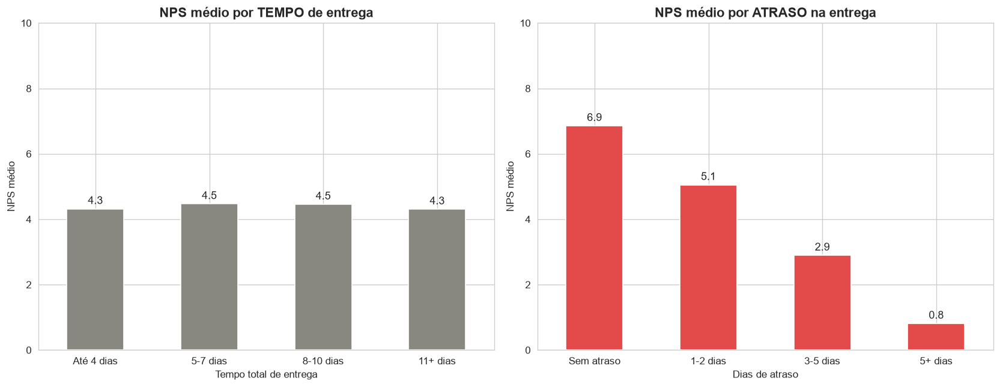
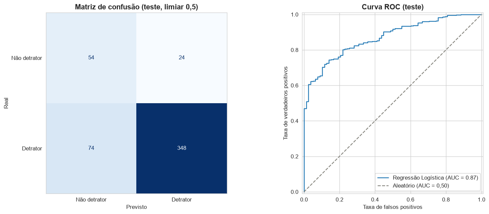
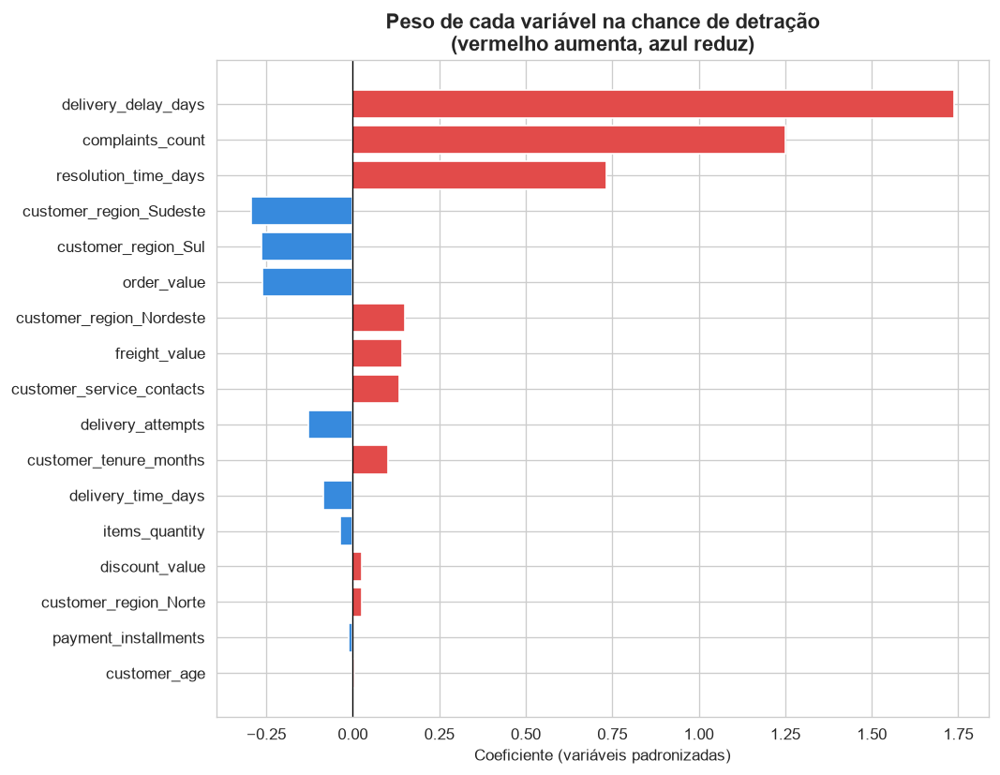
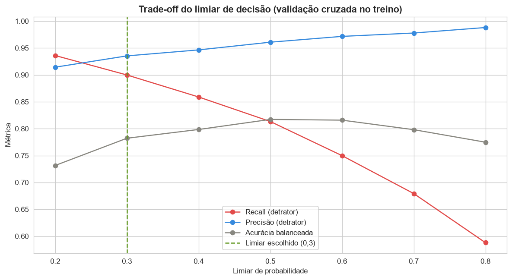

# Análise Preditiva de NPS para E-commerce

Análise de dados operacionais de um e-commerce para entender o que derruba a satisfação do cliente e antecipar quais clientes se tornarão detratores. O modelo identifica 9 em cada 10 detratores no limiar de decisão adotado, antes da aplicação da pesquisa de NPS e usando apenas dados de pedido, logística e atendimento, o que permite ao time de atendimento agir de forma proativa.

A análise exploratória nasceu de um desafio técnico da pós-graduação em IA (FIAP). As etapas de modelagem preditiva e de dashboard foram desenvolvidas por iniciativa própria, além do escopo original.

## Sumário

1. [Objetivo do projeto](#objetivo-do-projeto)
2. [O problema de negócio](#o-problema-de-negócio)
3. [Base de dados](#base-de-dados)
4. [Metodologia](#metodologia)
5. [Principais descobertas](#principais-descobertas)
6. [Modelo preditivo](#modelo-preditivo)
7. [Recomendações](#recomendações)
8. [Limitações](#limitações)
9. [Estrutura do repositório](#estrutura-do-repositório)
10. [Como reproduzir](#como-reproduzir)
11. [Tecnologias utilizadas](#tecnologias-utilizadas)
12. [Próximos passos](#próximos-passos)
13. [Autor](#autor)

## Objetivo do projeto

Com o crescimento do e-commerce, a empresa passou a lidar com um volume cada vez maior de pedidos, entregas e interações com clientes. Esse crescimento trouxe ganhos de escala, mas também revelou uma alta variabilidade no Net Promoter Score (NPS) entre diferentes perfis de consumidores.

O objetivo deste projeto é transformar dados operacionais (informações de pedidos, logística e atendimento) em insights acionáveis, respondendo à seguinte pergunta central:

> Quais fatores operacionais realmente influenciam a satisfação do cliente, e como a empresa pode agir de forma proativa para melhorar a experiência antes mesmo da aplicação da pesquisa de NPS?

A análise exploratória responde à primeira metade da pergunta. O modelo preditivo responde à segunda, atribuindo a cada pedido uma probabilidade de detração calculada apenas com informações disponíveis antes da pesquisa.

## O problema de negócio

Atualmente o NPS é coletado apenas após o encerramento da jornada de compra. Isso limita a capacidade da empresa de antecipar problemas e atuar de forma preventiva, deixando a operação em uma postura reativa: o cliente insatisfeito só é identificado quando já é tarde demais para reverter a situação.

O NPS é especialmente importante para um e-commerce porque, nesse setor, o concorrente está a um clique de distância e o custo de troca para o cliente é muito baixo. Reter quem já comprou protege a margem diretamente, e o NPS funciona como um indicador antecedente de retenção e crescimento.

## Base de dados

O arquivo `desafio_nps_fase_1.csv` contém 2.500 registros, cada um representando um pedido e o cliente associado. A base reúne informações de pedido, logística, atendimento e indicadores internos de negócio.

### Dicionário de dados

| Coluna | Descrição |
|--------|-----------|
| `customer_id` | Identificador único do cliente |
| `order_id` | Identificador único do pedido |
| `customer_age` | Idade do cliente |
| `customer_region` | Região geográfica do cliente |
| `customer_tenure_months` | Tempo de relacionamento do cliente com a empresa (em meses) |
| `order_value` | Valor total do pedido |
| `items_quantity` | Quantidade de itens no pedido |
| `discount_value` | Valor de desconto aplicado ao pedido |
| `payment_installments` | Número de parcelas do pagamento |
| `delivery_time_days` | Tempo total de entrega (em dias) |
| `delivery_delay_days` | Quantidade de dias de atraso na entrega |
| `freight_value` | Valor do frete |
| `delivery_attempts` | Número de tentativas de entrega |
| `customer_service_contacts` | Número de contatos do cliente com o atendimento |
| `resolution_time_days` | Tempo para resolução de problemas (em dias) |
| `complaints_count` | Número de reclamações registradas pelo cliente |
| `repeat_purchase_30d` | Indica se houve recompra em até 30 dias (0 = não, 1 = sim) |
| `csat_internal_score` | Score interno de satisfação do cliente |
| `nps_score` | Nota de satisfação do cliente (NPS), de 0 a 10, coletada após a compra |

### Variável alvo

A variável alvo é o `nps_score`. Ela foi escolhida por ser a única variável da base que mede diretamente a percepção e a lealdade do cliente, enquanto todas as demais são dados operacionais. A partir dela foi criada uma variável categórica seguindo a metodologia oficial do NPS:

- **Detrator:** nota de 0 a 6
- **Neutro:** nota de 7 a 8
- **Promotor:** nota de 9 a 10

Na etapa de modelagem, essa categoria foi reduzida a uma variável binária (`isdetrator`), pelos motivos explicados na seção [Modelo preditivo](#modelo-preditivo).

## Metodologia

O trabalho foi organizado em três etapas, cada uma em um notebook dedicado, que devem ser executados em ordem.

### 1. Tratamento e preparação dos dados (`01_tratamento.ipynb`)

A base foi carregada e passou por verificações de qualidade: checagem de tipos de dados, identificação de valores nulos, identificação de registros e identificadores duplicados, e uma verificação de consistência (sanity check) para detectar valores impossíveis, como valores negativos onde não deveria haver ou notas de NPS fora do intervalo de 0 a 10.

A base não apresentou valores nulos nem registros duplicados, e todos os valores mostraram-se dentro de faixas plausíveis. Por fim, foi criada a variável alvo categórica (`nps_category`) e a base tratada foi salva separadamente da original, preservando o dado bruto.

### 2. Análise exploratória (`02_eda.ipynb`)

A análise seguiu uma lógica que vai do geral para o específico. Primeiro foi observada a distribuição da variável alvo, depois a matriz de correlação foi usada como bússola para identificar quais variáveis merecem investigação, e em seguida cada fator relevante foi analisado em profundidade contra o NPS. Cada gráfico é acompanhado de uma interpretação de negócio, priorizando a comunicação sobre a estatística pura. Todos os gráficos são exportados para `reports/figures/`.

### 3. Modelagem preditiva (`03_modelagem.ipynb`)

Construção de um modelo de classificação que estima a probabilidade de um cliente se tornar detrator usando apenas variáveis operacionais disponíveis antes da pesquisa de NPS. O notebook cobre o controle de vazamento de dados, a definição de um baseline, a comparação entre três algoritmos por validação cruzada, a interpretação do modelo escolhido e a escolha do limiar de decisão. Gera o modelo treinado e a base pontuada que alimenta o dashboard.

## Principais descobertas

**A base é predominantemente detratora.** Cerca de 84% dos clientes são detratores, o que evidencia um problema estrutural de satisfação.

**O perfil do cliente não influencia o NPS.** Idade, tempo de relacionamento, região e valor do pedido apresentaram correlação praticamente nula com a satisfação. O que define o NPS não é quem o cliente é, e sim a experiência operacional entregue a ele.

**O atraso na entrega é o principal fator de insatisfação.** É a variável com maior correlação negativa com o NPS. Um detalhe importante é que não é o tempo total de entrega que importa (correlação praticamente nula), e sim o atraso em relação ao prazo prometido. Existe um ponto de ruptura claro: a partir de 3 dias de atraso, o cliente já se torna detrator.



**O atraso é a regra, não a exceção.** Cerca de 89% dos pedidos são entregues com algum atraso, o que sugere que o prazo prometido está mal calibrado, e não que a operação seja necessariamente lenta.

**Reclamações e contatos com o atendimento caminham juntos.** As duas variáveis apresentam correlação alta entre si (0,75), indicando que provavelmente fazem parte do mesmo episódio de insatisfação.

**A satisfação está diretamente ligada à receita.** Nenhum detrator realizou recompra em 30 dias, enquanto 100% dos promotores recompraram. A direção dessa relação é importante: é a satisfação que leva à recompra, e não o contrário.

**O indicador interno de satisfação (CSAT) mostrou-se mal calibrado.** Ele dá forte peso ao tempo de resolução de problemas, um fator de baixo impacto no NPS, e subestima o atraso, que é o mais relevante.

## Modelo preditivo

### A tarefa

Prever se o cliente será detrator (NPS de 0 a 6) usando apenas variáveis operacionais conhecidas **antes** da pesquisa de NPS. O resultado é entregue como um score de risco por pedido, permitindo que o atendimento priorize contatos proativos.

A variável alvo foi binarizada (detrator contra não detrator) porque as categorias neutro (281 casos) e promotor (110 casos) são pequenas demais para serem separadas de forma confiável, e porque a pergunta de negócio é binária. A versão de três classes foi testada e confirmou essa limitação.

### Controle de vazamento de dados

Quatro variáveis foram excluídas por representarem informação indisponível no momento da previsão:

| Coluna | Motivo da exclusão |
|---|---|
| `nps_score`, `nps_category` | São a variável alvo |
| `repeat_purchase_30d` | Ocorre nos 30 dias posteriores à avaliação |
| `csat_internal_score` | Pesquisa de satisfação, provavelmente respondida junto com o NPS |
| `customer_id`, `order_id` | Identificadores, sem significado preditivo |

As variáveis `complaints_count`, `customer_service_contacts` e `resolution_time_days` foram mantidas sob a **premissa declarada** de que ocorrem durante o ciclo do pedido, antes da coleta do NPS. A base não possui datas, portanto essa premissa não pôde ser verificada e está registrada entre as limitações.

O impacto da exclusão do CSAT foi medido: incluí-lo elevaria o ROC-AUC de 0,895 para 0,896, ou seja, a exclusão não teve custo de desempenho.

### Comparação entre algoritmos

Três famílias de algoritmo foram comparadas por validação cruzada estratificada de 5 divisões, dentro do conjunto de treino. O baseline é o classificador trivial, que responde "detrator" para todos.

| Modelo | Acurácia | Acurácia balanceada | ROC-AUC | Desvio do ROC-AUC | F1 macro |
|---|---|---|---|---|---|
| Baseline (classificador trivial) | 0,844 | 0,500 | 0,500 | 0,000 | 0,458 |
| **Regressão Logística** | 0,814 | **0,817** | **0,895** | **0,010** | 0,731 |
| Random Forest | 0,835 | 0,779 | 0,883 | 0,022 | 0,734 |
| HistGradientBoosting | 0,854 | 0,719 | 0,870 | 0,025 | 0,719 |

**Por que a acurácia não foi usada como critério.** Numa base com 84% de detratores, o classificador trivial já alcança 84% de acurácia sem aprender nada. Note que o ranking por acurácia é praticamente o inverso do ranking por acurácia balanceada: o HistGradientBoosting tem a maior acurácia e o pior desempenho balanceado, justamente por se aproximar da estratégia do chute. A avaliação foi feita por ROC-AUC (capacidade de ordenar por risco), acurácia balanceada e F1 macro.

**Modelo escolhido: Regressão Logística**, com `class_weight='balanced'`. Melhor ROC-AUC, melhor acurácia balanceada e o menor desvio entre as divisões da validação cruzada, além de ser diretamente interpretável. Como os modelos mais complexos não trouxeram ganho, optou-se pelo mais simples.

### Desempenho no conjunto de teste

O conjunto de teste (500 pedidos, 20% da base) foi usado uma única vez, ao final.

| Métrica | Baseline | Regressão Logística |
|---|---|---|
| ROC-AUC | 0,500 | **0,870** |
| Acurácia balanceada | 0,500 | **0,759** |
| Recall (detrator) | 1,000 | 0,824 |
| Precisão (detrator) | 0,844 | 0,935 |



Dos 422 detratores reais, o modelo identifica 348 e deixa passar 74. Dos 78 não detratores, reconhece 54 e sinaliza 24 por engano. Quando o modelo aponta um detrator, acerta em 94% das vezes.

### O que o modelo aprendeu



Com as variáveis padronizadas, os coeficientes são comparáveis entre si. O resultado **confirma, por outra técnica, o achado central da análise exploratória**: `delivery_delay_days` é de longe a variável mais forte (+1,74), enquanto `delivery_time_days` é indistinguível de zero (-0,08). Em seguida vêm `complaints_count` (+1,25) e `resolution_time_days` (+0,73). As variáveis de perfil do cliente e as características do pedido ficam todas abaixo de 0,3 em valor absoluto.

A variável `customer_service_contacts` recebe peso baixo (+0,14) apesar de relevante na análise exploratória. Isso é efeito da multicolinearidade com `complaints_count` (correlação de 0,75): as duas carregam quase a mesma informação, e o modelo concentra o peso em uma delas. Em modelos com variáveis correlacionadas, o coeficiente individual não deve ser lido como ranking definitivo de importância.

### Limiar de decisão

O corte padrão de 0,5 é uma decisão de negócio, não estatística. O trade-off foi avaliado com probabilidades obtidas por validação cruzada no treino, sem tocar no conjunto de teste.



**Limiar adotado: 0,3**, que eleva o recall de detratores de 0,813 para 0,900 com uma queda de precisão de apenas 0,961 para 0,935. A justificativa é o custo assimétrico dos erros: deixar de identificar um cliente insatisfeito significa perder a chance de reverter (e nenhum detrator recompra em 30 dias), enquanto contatar um cliente que avaliaria bem tem custo baixo. O limiar não foi reduzido além disso porque contato em excesso incomoda e a capacidade de atendimento é finita.

O modelo é entregue como score de probabilidade, e o limiar pode ser recalibrado conforme a capacidade operacional do time.

### Saídas geradas

O modelo final é retreinado com a base completa e exportado em `models/modelo_detrator.joblib`. A base pontuada é salva em `data/processed/nps_com_score.csv`, com as colunas `prob_detrator` e `faixa_risco`:

| Faixa de risco | Pedidos | Taxa real de detratores | NPS médio | Atraso médio (dias) |
|---|---|---|---|---|
| Baixo (< 0,3) | 472 | 45,1% | 7,16 | 0,68 |
| Médio (0,3 a 0,7) | 594 | 82,0% | 5,32 | 1,57 |
| Alto (> 0,7) | 1.434 | 98,3% | 3,07 | 2,94 |

Como o modelo final viu todas as linhas, essas probabilidades são otimistas e servem para visualização e priorização, não para medir desempenho. O desempenho oficial é o do conjunto de teste.

Vale notar a leitura da faixa "Baixo": numa base com 84% de detratores, risco baixo é relativo, e não significa cliente satisfeito.

## Recomendações

1. **Recalibrar o prazo de entrega prometido.** Como o problema não é a velocidade e sim o atraso em relação à promessa, ajustar o prazo prometido em cerca de 2 dias colocaria a maior parte dos pedidos dentro do prazo, sem qualquer investimento adicional em logística. O ajuste deve ser calibrado com dados reais, sem exagerar, para não reduzir a conversão de vendas.

2. **Ouvir e categorizar as reclamações.** Hoje a empresa registra que houve uma reclamação, mas não o motivo. Passar a registrar a categoria da reclamação permite atacar a causa raiz em análises futuras.

3. **Priorizar logisticamente os pedidos com maior risco de atraso elevado.** O atraso alto (3 dias ou mais) é o que causa o maior estrago no NPS.

4. **Usar o score de risco para contato proativo.** A faixa de risco alto concentra 1.434 pedidos com 98,3% de detração real. Priorizar esses clientes com acompanhamento da entrega ou compensação permite agir antes de a experiência virar uma nota ruim.

5. **Registrar as datas dos eventos operacionais.** Sem elas não é possível confirmar a ordem entre reclamação, atendimento e pesquisa, nem validar o modelo em um período futuro. É o principal bloqueio para levar este modelo a produção.

## Limitações

- A base é **sintética**, fornecida como parte do desafio técnico que originou a análise. As relações tendem a ser mais limpas do que em dados reais, e os resultados não devem ser lidos como expectativa de produção.
- Os números absolutos observados são expressivos e devem ser confirmados com um histórico maior de dados antes de definir metas oficiais.
- A análise identifica correlações, não causalidade. As relações foram interpretadas com bom senso de negócio, mas sem afirmar mecanismos de causa, e o mesmo vale para os coeficientes do modelo.
- A premissa de que reclamações, contatos e tempo de resolução ocorrem antes da coleta do NPS **não pôde ser verificada**, porque a base não possui datas.
- Sem dimensão temporal, não foi possível fazer validação out-of-time, que é o teste mais próximo do uso real do modelo.
- A recomendação de recalibrar o prazo de entrega tem um limite: prazos prometidos longos demais podem reduzir a conversão de vendas.

## Estrutura do repositório

```
nps-preditivo-ecommerce/
├── data/
│   ├── raw/                        # base de dados original, intocada
│   │   └── desafio_nps_fase_1.csv
│   └── processed/                  # bases geradas pelos notebooks
│       ├── nps_tratado.csv         # gerada pelo notebook 01
│       └── nps_com_score.csv       # gerada pelo notebook 03 (insumo do dashboard)
├── models/
│   └── modelo_detrator.joblib      # pipeline treinado (pré-processamento + modelo)
├── notebooks/
│   ├── 01_tratamento.ipynb         # carga, verificação de qualidade e preparação
│   ├── 02_eda.ipynb                # análise exploratória
│   └── 03_modelagem.ipynb          # modelo de classificação de detratores
├── reports/
│   ├── figures/                    # gráficos exportados (01 a 13 da EDA, 14 a 16 da modelagem)
│   └── NPS_Preditivo_Apresentacao.pdf
├── README.md
└── requirements.txt
```

## Como reproduzir

1. Clone o repositório:

```bash
git clone https://github.com/JoaoPaulo-66/nps-preditivo-ecommerce.git
cd nps-preditivo-ecommerce
```

2. (Opcional, mas recomendado) Crie e ative um ambiente virtual:

```bash
python -m venv venv
# Windows
venv\Scripts\activate
# Linux / Mac
source venv/bin/activate
```

3. Instale as dependências:

```bash
pip install -r requirements.txt
```

4. Execute os notebooks na ordem, de cima para baixo:

| Notebook | O que faz | O que gera |
|---|---|---|
| `01_tratamento.ipynb` | carga e verificação de qualidade | `data/processed/nps_tratado.csv` |
| `02_eda.ipynb` | análise exploratória | gráficos 01 a 13 em `reports/figures/` |
| `03_modelagem.ipynb` | modelo preditivo | gráficos 14 a 16, `models/modelo_detrator.joblib` e `data/processed/nps_com_score.csv` |

Os notebooks 02 e 03 dependem do arquivo gerado pelo notebook 01, por isso a ordem importa. Para garantir a reprodutibilidade, recomenda-se reiniciar o kernel e executar todas as células na ordem (Restart & Run All).

Todas as divisões aleatórias usam `random_state=42`, de forma que os números deste README são reproduzidos exatamente. Pequenas diferenças de casas decimais podem aparecer com versões diferentes do scikit-learn, sem alterar as conclusões.

## Tecnologias utilizadas

- Python 3
- pandas (manipulação de dados)
- numpy (operações numéricas)
- matplotlib e seaborn (visualização)
- scikit-learn (pré-processamento, modelagem e validação)
- joblib (persistência do modelo)
- Jupyter Notebook

## Próximos passos

- **Dashboard em Power BI** sobre `nps_com_score.csv`, com a lista de pedidos priorizada por risco e o acompanhamento dos fatores operacionais que mais pesam na detração.

## Autor

João Paulo Rezende de Oliveira

www.linkedin.com/in/joaopaulorezendeoliveira
